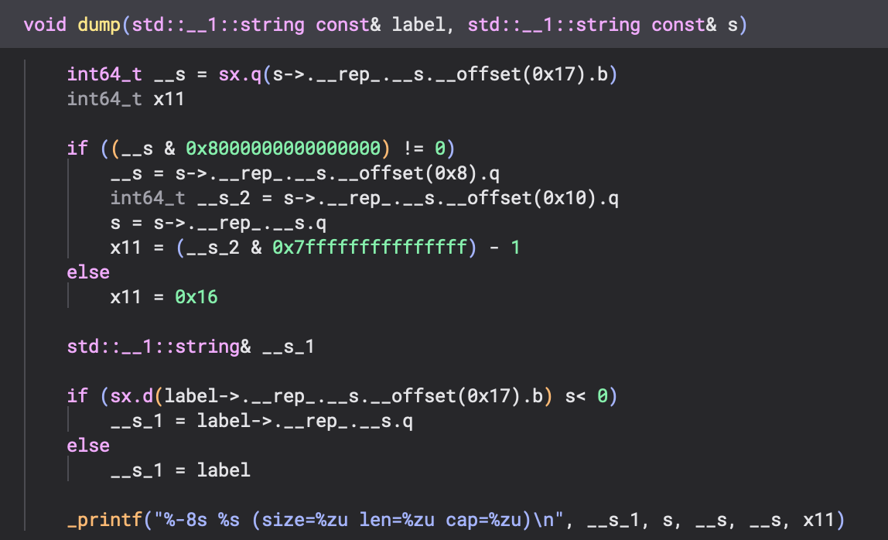
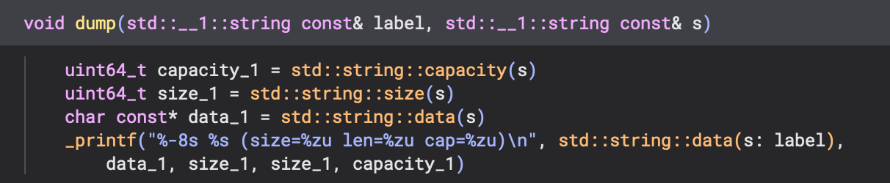

# Outliner

A Binary Ninja plugin that replaces inlined code with function calls.

You write a pattern that describes a fragment of MLIL, together with the C
signature of the function it was inlined from. During analysis the plugin
replaces every match with a call to that function, so MLIL, HLIL and pseudo-C
show the call instead of the inlined body.

> [!WARNING]
> This whole project is vibecoded: the code and documentation were written by
> an AI coding assistant, with little of it reviewed by hand.

## Example

This function prints a string with its size and capacity. Binary Ninja
decompiles it with libc++'s string accessors inlined:



With patterns for `data()`, `size()` and `capacity()`, the same function
calls them instead:



The `data()` pattern looks like this. libc++'s `std::string::data()`, as
clang inlines it on arm64, tests the short-string flag in byte 0x17 and
returns either the heap pointer or the object's own buffer:

```
signature: char const* `std::string::data`(`std::__1::string` const* s) __pure
$s : /string(?![>\w])/

if (sx(load_struct.b($s, 0x17)) s< 0) then long else short
long:
    $ret = load_struct.q($s, 0)
    goto done
short:
    $ret = $s
    goto done
done:
```

Every function whose MLIL contains this diamond, on a value typed as a
`std::string`, then shows `ret = std::string::data(s)` in its place. The
pattern language is described in [docs/patterns.md](docs/patterns.md).

## Requirements

- Binary Ninja 6.1, with Python scripting enabled (the pattern editor is a
  Qt dialog that runs in Binary Ninja's Python).
- A stable Rust toolchain and libclang (used to generate the API bindings).

## Building

```bash
cargo xtask package
```

This builds the plugin in release mode and assembles it in `target/outliner`:
the library and the Python package that loads it (`dist/outliner`). That
folder is the whole plugin, ready to copy into Binary Ninja's plugins folder
or to archive for distribution. Arguments after `package` are passed to
`cargo build`, such as `--offline`.

The build links against the Binary Ninja installation recorded in Binary
Ninja's `lastrun` file. Set `BINARYNINJADIR` to use a different one.

`binaryninjacore-sys` is pinned in `crates/outliner-plugin/Cargo.toml` to a
[binaryninja-api](https://github.com/Vector35/binaryninja-api) commit whose
core ABI matches Binary Ninja 6.1. For another version, change `rev` to the
matching commit, or build against a local checkout by adding this to
`~/.cargo/config.toml` (or to the repository's `.cargo/config.toml`):

```toml
[patch."https://github.com/Vector35/binaryninja-api.git"]
binaryninjacore-sys = { path = "/path/to/binaryninja-api/rust/binaryninjacore-sys" }
```

On Linux, if the build fails with `stddef.h` not found, install clang's
headers (`clang` and `libclang-dev`), or set
`BINDGEN_EXTRA_CLANG_ARGS="-I$(clang -print-resource-dir)/include"`.

## Installing

```bash
cargo xtask install
```

This packages the plugin and copies `target/outliner` into Binary Ninja's
plugins folder as `outliner/`. The plugins folder is
`~/Library/Application Support/Binary Ninja/plugins` on macOS,
`~/.binaryninja/plugins` on Linux and `%APPDATA%\Binary Ninja\plugins` on
Windows, or the `plugins` folder of `BN_USER_DIRECTORY` when that is set.
Pass `--plugins-dir DIR` to install somewhere else. Restart Binary Ninja
after installing.

To install by hand, copy the `target/outliner` folder into the plugins folder.
It has to stay a folder: Binary Ninja loads native plugins only from the top
level of its plugins folder, and the Python package in it loads the library
from the folder instead.

## Usage

The commands are under **Plugins > Outliner** and in the right-click menu:

- **Manage Patterns...** opens the pattern editor, with one tab per pattern.
  It loads and saves pattern files, tests the selected pattern against the
  whole binary without changing anything, and applies the patterns.
- **Create Pattern From Selection...** drafts a pattern from the lines
  selected in the MLIL view. The draft has the parameters, result, type
  constraints and labels filled in; you name the function in its signature
  line.
- **Create Pattern From Function...** drafts a pattern from the current
  function's own body, for a function that also exists out of line.
- **Show Function As Pattern Text** prints the current function's MLIL in
  pattern syntax.

Patterns are stored in the database (`.bndb`). Applying them reanalyzes all
functions. A pattern file holds several patterns, separated by lines that
contain only `---`.

The setting **Outliner > Retype Result Variables** (on by default) gives the
variable that receives an outlined call's result the call's return type.

### Python API

The plugin folder is also a Python package, so scripts and the console can
use it directly:

```python
import outliner

func = bv.get_functions_by_name("main")[0]
print(outliner.function_pattern_text(func))           # MLIL in pattern syntax
draft = outliner.draft_instructions(func, 4, 11)       # a pattern for MLIL 4..11
text = draft.text.replace("outlined", "my_function")   # name the function
report = outliner.test_pattern(bv, text, focus=func)
for hit in report.pattern.hits:
    print(hex(hit.address), hit.function, hit.text)
outliner.add_pattern(bv, text)                         # save; reanalysis starts
bv.update_analysis_and_wait()                          # wait for it
```

Failures raise `outliner.OutlinerError`. The functions are documented in
`dist/outliner/api.py` (`help(outliner)` in the console), and
`outliner.manual()` returns the pattern manual.

### AI agents

`skills/outliner/SKILL.md` is a skill that teaches an AI agent to find
inlined code, draft and test patterns, and apply them through the Python API.
It can be copied into any agent that reads skills in this format.

When Sidekick, Binary Ninja's AI assistant, is installed, the plugin adds
the skill to Sidekick's Library at startup as the item **Outliner**, which
chats can use with `/outliner`. A newer version replaces it unless it was
edited in Sidekick. The setting **Outliner > Add Skill to Sidekick** turns
this off; while it is on, a deleted item is added again at the next start.

## How it works

The plugin adds the activity `extension.outliner.outlinePatterns` to the
`core.function.metaAnalysis` workflow, just before HLIL is generated, so
patterns are matched against the MLIL the MLIL view shows. For each function
it finds the matches, builds a new MLIL function with each match replaced by
a call, and repeats, up to 12 rounds, so that patterns can match calls made
in earlier rounds. Each signature gets a call target: a function-typed data
variable with an external symbol in a synthetic `outlined` section.

## Development

`crates/outliner-core` holds the pattern language, the matcher and the
rewrite planner, with no Binary Ninja dependency. `crates/outliner-plugin`
binds it to Binary Ninja through `binaryninjacore-sys` and holds the MLIL
reader, the rewriter, the workflow activity and the commands.

```bash
cargo test -p outliner-core
```
